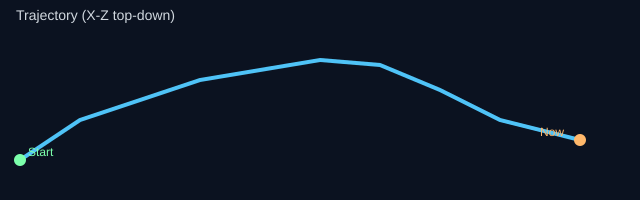
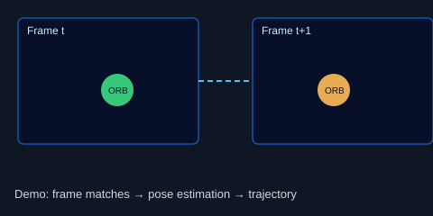
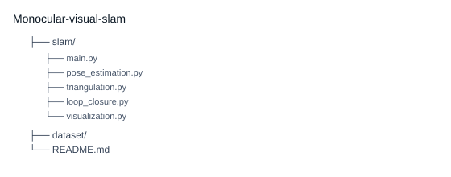
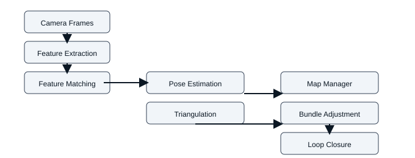

# Monocular Visual SLAM (Python)


Real-time, modular **monocular visual SLAM** pipeline in Python using ORB features, RANSAC pose estimation, triangulation, local bundle adjustment, loop-closure correction, and relocalization. The runtime now includes production-oriented controls such as structured logging, headless execution, JSON-based config overrides, artifact export, and run summaries.

> Status: research-grade prototype with corrected geometry, explicit monocular scale handling, cross-keyframe BA associations, relocalization, loop detection, automated unit tests, and reproducible evaluation tooling.

> Validation status: research-grade prototype. The repository contains automated tests, a CI workflow, KITTI evaluation/benchmark tooling, an optional external metric-motion adapter, and long-duration validation scripts. These tools do not by themselves prove benchmark accuracy or real-world stability; those claims require recorded successful runs on the intended datasets and hardware.

## Demo

Live demo (lightweight preview):



Example frames preview:



If you prefer raster images, replace the SVGs with `docs/demo.gif` and `docs/trajectory.png`.

## Highlights

- ORB + CLAHE feature extraction
- BFMatcher + Lowe ratio test + match deduplication
- Essential matrix (RANSAC) -> relative pose `R, t`
- Explicit monocular scale policy with optional wheel/IMU/GNSS metric-scale adapter
- Keyframe-based sparse map management + pruning
- Local bundle adjustment (SciPy least-squares, sparse Jacobian)
- BoW/TF-IDF place recognition + Essential-matrix verification + smooth pose-graph correction
- Lost tracking detection + PnP-based relocalization
- Camera calibration utility (checkerboard)
- Structured logging to console and file
- Headless mode for servers and batch runs
- JSON config overrides for reproducible runtime tuning
- Run artifacts: summary JSON + trajectory CSV
- Live overlay: FPS, features, matches, inliers, map points
- 2D trajectory + 3D map visualization (Open3D)

## Repository layout

This repo keeps the SLAM package under `slam/` and runtime config at the repository root:

```
slam/
  main.py
  config.py
  feature_extraction.py
  feature_matching.py
  pose_estimation.py
  triangulation.py
  map_manager.py
  keyframe_manager.py
  scale_estimator.py
  bundle_adjustment.py
  loop_closure.py
  bow_loop_closure.py
  relocalization.py
  trajectory.py
  sensor_scale.py
  kitti_evaluation.py
  runtime_validation.py
  visualization.py
  calibration.py
  kitti_loader.py
scripts/
  kitti_batch_evaluation.py
  kitti_large_benchmark.py
  real_world_validation.py
  stress_validation.py
tests/
  test_sensor_scale.py
  test_bow_loop_closure.py
  test_kitti_large_benchmark.py
config.production.json
requirements.txt
dataset/
  dataset/
    sequences/00/... (KITTI images live here)
    poses/*.txt      (ground-truth poses)
```

Project structure (visual):



## Quick start

### 1) Install

Python **3.10+** recommended.

```bash
python -m venv .venv
# Windows (PowerShell):
.venv\Scripts\Activate.ps1
# Linux/macOS:
source .venv/bin/activate
python -m pip install -U pip
python -m pip install -r requirements.txt
```

### 2) Calibrate your camera (recommended)

Print a checkerboard and run:

```bash
python slam/calibration.py --source 0 --rows 9 --cols 6 --n 20
```

The calibration tool also writes `slam/calibration_result.npz`. Use it directly at runtime:

```bash
python slam/main.py --source 0 --calibration slam/calibration_result.npz --summary-json --save-trajectory
```

The runtime undistorts frames using the measured lens distortion coefficients before feature extraction.

Copy the printed `CAMERA_PARAMS` into `slam/config.py` or provide them through a JSON config override.

If you skip calibration, the pipeline will still run, but tracking quality and scale will likely degrade.

### 3) Run SLAM

Webcam:

```bash
python slam/main.py --source 0 --summary-json --save-trajectory
```

Video file:

```bash
python slam/main.py --source path/to/video.mp4
```

KITTI odometry sequence (expects an `image_0/` folder inside):

```bash
python slam/main.py --source "dataset/dataset/sequences/00" --config-file "config.production.json" --summary-json --save-trajectory
```

Controls:

- Press `q` in the OpenCV window to quit.

## CLI options

From `slam/main.py`:

- `--source`: webcam index (`0`), video path, or KITTI sequence folder
- `--scale`: resize factor applied to frames (also scales intrinsics)
- `--width`, `--height`: request webcam capture resolution
- `--no-ba`: disable bundle adjustment (faster, less accurate)
- `--no-viz`: disable 3D plotting
- `--headless`: disable all GUI windows for remote or batch execution
- `--config-file`: load JSON overrides for `CAMERA_PARAMS` / `PIPELINE_PARAMS`
- `--calibration`: load calibrated camera intrinsics/distortion from `.npz`
- `--metrics-file`: choose the runtime health metrics JSON path
- `--metric-scale-csv`: optional synchronized per-frame metric-motion CSV
- `--output-dir`: choose where logs and artifacts are written
- `--summary-json`: emit `run_summary.json`
- `--save-trajectory`: emit `trajectory_positions.csv` and full-pose `trajectory_poses.csv`
- `--max-frames`: stop automatically after a bounded number of frames
- `--log-level`, `--log-file`: control observability

Examples:

```bash
# Headless batch run with artifacts
python slam/main.py --source "dataset/dataset/sequences/00" --headless --summary-json --save-trajectory --output-dir outputs/kitti_00

# Override thresholds from JSON and stop after 500 frames
python slam/main.py --source 0 --config-file "config.production.json" --max-frames 500
```

## Configuration

Edit `slam/config.py`:\

- `CAMERA_PARAMS`: `fx, fy, cx, cy` intrinsics used by pose/triangulation
- `PIPELINE_PARAMS`: thresholds (min features/matches/inliers), map caps, loop-check cadence, etc.
- `config.production.json`: example runtime override file for reproducible runs without editing source code

## Operational outputs

When you run with `--summary-json` or `--save-trajectory`, the pipeline writes:

- `slam.log`: structured runtime logs
- `run_summary.json`: frame counts, loop closures, relocalizations, FPS estimate, map statistics
- `runtime_metrics.json`: effective FPS, P50/P95/P99 latency, tracking success/failure rate, slow-frame rate and feature/match/inlier averages
- `trajectory_positions.csv`: per-frame camera positions
- `trajectory_poses.csv`: full camera-to-world 3x4 poses for rotation-aware evaluation

Default output location:

```text
outputs/latest_run/
```

## Dataset notes (KITTI)

- Use `dataset/dataset/sequences/<id>` as the `--source` (this folder contains `image_0/`).
- If `calib.txt` exists in the sequence folder, it is auto-parsed and applied at runtime.
- Ground-truth poses live in `dataset/dataset/poses/*.txt`; the evaluator consumes them separately so runtime code does not depend on ground truth.

## KITTI evaluation (ATE / RPE)

A small evaluation utility is included to compute Absolute Trajectory Error (ATE) and
Relative Pose Error (RPE) against KITTI ground truth. It performs a similarity
alignment (Umeyama) to account for monocular scale ambiguity before reporting ATE.

Usage example:

```bash
python slam/kitti_evaluation.py --gt dataset/dataset/poses/00.txt --est outputs/latest_run/trajectory_poses.csv
```

The script accepts KITTI-style pose files (3x4 per line) for `--gt` and either
the `trajectory_positions.csv` produced by the pipeline (`frame_idx,x,y,z`) or
an `Nx3` positions file for `--est`.

## KITTI Evaluation

Run the evaluator against a freshly generated full-pose trajectory:

```bash
python slam/main.py --source "dataset/dataset/sequences/00" --headless --save-trajectory --summary-json --output-dir outputs/kitti_00
python slam/kitti_evaluation.py --gt dataset/dataset/poses/00.txt --est outputs/kitti_00/trajectory_poses.csv
```

The evaluator reports similarity-aligned ATE plus rotation-aware RPE when the full pose CSV is supplied. The previously documented numeric result was produced before the geometry/association fixes and is intentionally no longer presented as a current benchmark.

For repeatable multi-run comparison, batch evaluation is available:

```bash
python scripts/kitti_batch_evaluation.py --gt dataset/dataset/poses/00.txt --est-dir outputs/ --pattern '**/trajectory_poses.csv' --output outputs/kitti_batch_metrics.json
```

## Troubleshooting

- **Black/empty Open3D window:** try updating GPU drivers, or run with `--no-viz` to confirm the rest of the pipeline works.
- **Imports fail:** run via `python "slam/main.py"` (so local imports resolve).
- **Poor tracking / frequent relocalization:** calibrate intrinsics, reduce motion blur, increase scene texture, or lower `--scale`.
- **Scale drift:** monocular SLAM cannot observe absolute metric scale from images alone; this project keeps an explicit internal scale of 1.0 unless an external metric cue is supplied.

Architecture overview:



## Real-world validation

A repeatable validation runner is included for a webcam or recorded video:

    python scripts/real_world_validation.py --source 0 --frames 300 --calibration slam/calibration_result.npz

# Long-duration stability gate (recorded video or webcam)
python scripts/stress_validation.py --source 0 --frames 3000 --calibration slam/calibration_result.npz

It runs headless, disables bundle adjustment for a stable latency baseline, and writes runtime metrics, a validation report, trajectories, and the normal SLAM log/summary.

The validation report checks configurable thresholds for tracking success rate, effective FPS, slow-frame rate, and P95 frame latency. These are engineering health gates, not accuracy guarantees. For metric accuracy, use a measured reference trajectory or an external sensor.

## Large-scale KITTI benchmark

The repository includes a multi-sequence benchmark runner that executes the SLAM pipeline on every available KITTI odometry sequence with ground truth, then aggregates ATE/RPE metrics:

```bash
python scripts/kitti_large_benchmark.py --dataset-root dataset/dataset --sequences 00 01 02 03 04 05
```

For a quick smoke benchmark, cap each sequence:

```bash
python scripts/kitti_large_benchmark.py --dataset-root dataset/dataset --sequences 00 01 02 --frames 500
```

The resulting `benchmark_summary.json` aligns estimated poses to ground truth by source frame ID, reports sample counts and ATE/RPE, and distinguishes run completion from accuracy acceptance. Each sequence's own `calib.txt` is required and loaded by the runtime. Accuracy thresholds are opt-in; without thresholds, `accuracy_passed` is `null` and `COMPLETED` means only that the run and metric calculation completed—not that the trajectory is accurate.

Optional accuracy gates (choose limits appropriate for your evaluation protocol):

```bash
python scripts/kitti_large_benchmark.py --dataset-root dataset/dataset --sequences 00 01 02 \
  --max-ate-rmse-m 5 --max-rpe-translation-rmse-m 1 --max-rpe-rotation-rmse-deg 5
```

The benchmark returns a non-zero exit code for execution failures, skipped requested sequences, or configured accuracy-gate failures. KITTI results are only meaningful when the dataset is complete and the camera/calibration and evaluation protocol are appropriate.

## Advanced loop closure

Loop closure now has a self-contained visual vocabulary and TF-IDF Bag-of-Words candidate index for ORB descriptors. It does not require native DBoW2 bindings, which keeps installation portable; the existing Essential-matrix RANSAC stage remains the geometric acceptance gate.

The vocabulary size is configured with `LOOP_CLOSURE_PARAMS["bow_words"]` in `slam/config.py`. This is a portable k-means vocabulary over float-converted ORB descriptors, not the native DBoW2 implementation. Geometric verification remains necessary, and precision/recall on a labelled revisit sequence has not been established by unit tests alone.

## Sensor-based metric scale

Monocular vision alone cannot recover absolute metric scale. The runtime can consume synchronized external metric-motion samples from wheel odometry or another calibrated source. The CSV contract is **per-frame displacement**, not cumulative distance: each row's `metric_delta_m` is the displacement in meters from frame `frame_idx - 1` to frame `frame_idx`. Frame IDs must be consecutive within the file, unique, and synchronized to the video/KITTI source. Do not put cumulative odometry distance in this column.

```text
frame_idx,metric_delta_m
1,0.12
2,0.15
3,0.18
```

Run with:

```bash
python slam/main.py --source 0 --metric-scale-csv sensor_motion.csv --calibration slam/calibration_result.npz
```

The `SensorScaleProvider` maintains a robust rolling median of metric/visual translation ratios. Invalid samples are rejected, malformed/non-contiguous CSVs fail at load time, and runtime samples are ignored when tracking skipped a frame so the visual and metric displacements would not describe the same interval. If no valid synchronized sample is available, the previous scale remains in use and a warning is logged. This adapter does not automatically synchronize or calibrate raw IMU/GNSS signals.

## Current limitations and validation

The core geometry and pipeline integration are implemented, but this remains a monocular research prototype rather than a safety-critical production SLAM stack.

Known limitations:

- Monocular scale is inherently unobservable from images alone; the default internal scale is arbitrary. Metric scale requires an external cue such as IMU, wheel odometry, GNSS, known baseline, or another calibrated prior.
- BoW/TF-IDF place recognition is stronger than the original descriptor-mean candidate stage, but learned place recognition or a native DBoW2/ORB-SLAM vocabulary may still improve very large environments.
- KITTI evaluation and multi-sequence benchmark sweeps are explicit offline steps; dataset downloads are intentionally not part of CI. No benchmark accuracy is claimed until measured results are retained.
- Long-duration profiling and target-hardware real-time validation still need to be performed on target machines.

The repository includes regression tests for coordinate-frame conversion, triangulation alignment, landmark/observation indexing, synthetic metric-scale recovery, BoW vocabulary training/ranking, trajectory frame IDs, benchmark alignment, and loop-correction consistency. The CI workflow defines syntax checks, linting, evaluation CLI validation, and pytest; the live Actions status must be checked separately. KITTI accuracy, labelled loop precision/recall, and real-camera stability remain data-/hardware-dependent acceptance gates.

For a real deployment, validate camera calibration, lighting/motion conditions, CPU/GPU load, memory growth, tracking-loss recovery, and trajectory drift on the target camera and hardware before relying on the output for navigation.

## Acknowledgements / references

This project follows standard building blocks from classical monocular VO/SLAM literature (feature-based matching, Essential matrix pose, triangulation, bundle adjustment, loop closure).
